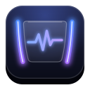
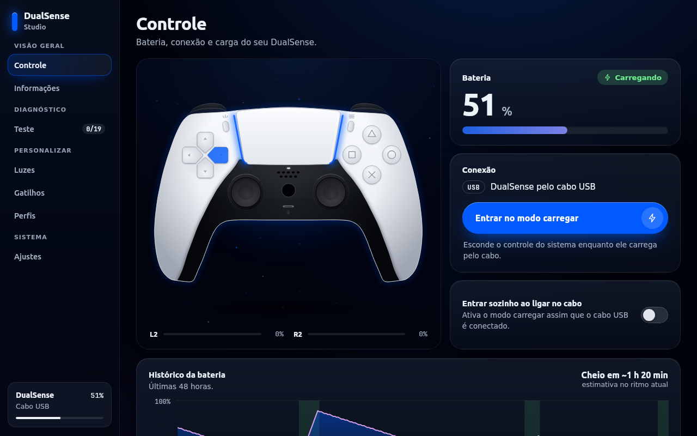
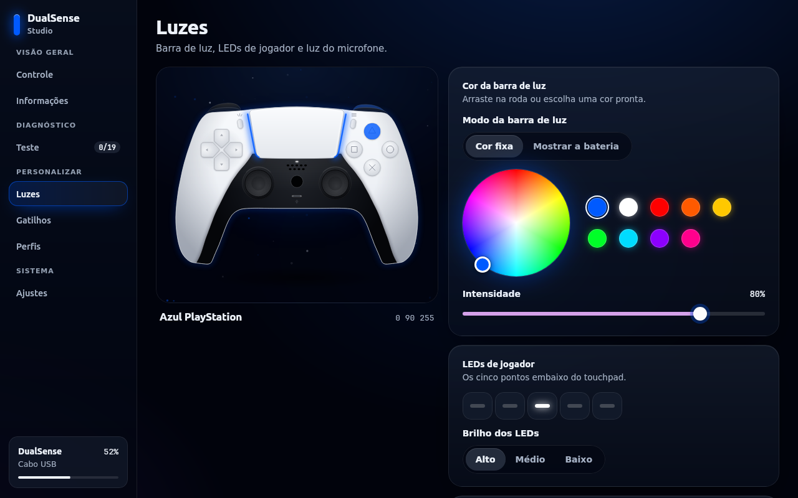
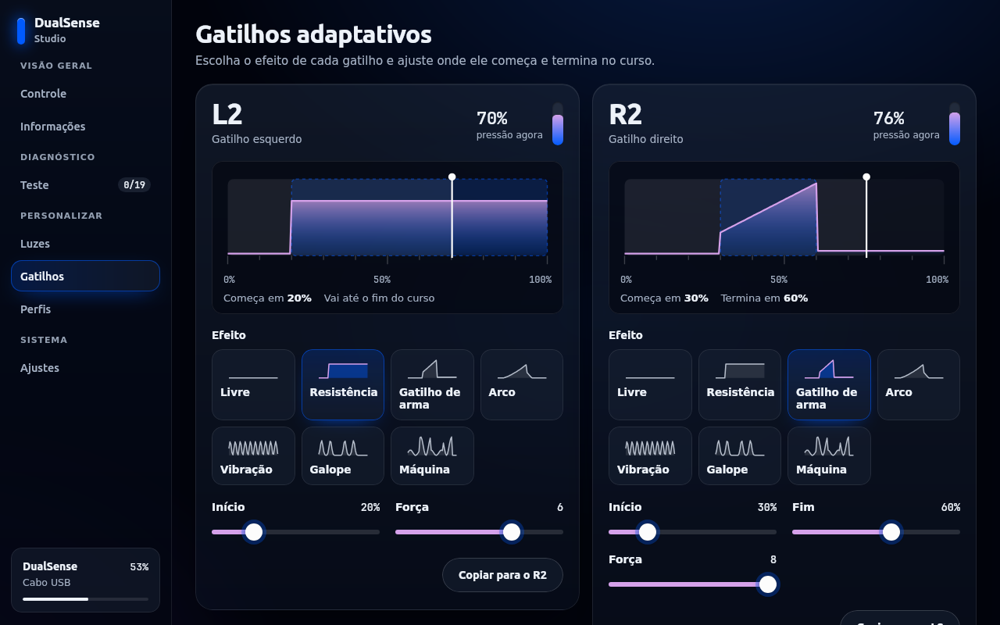
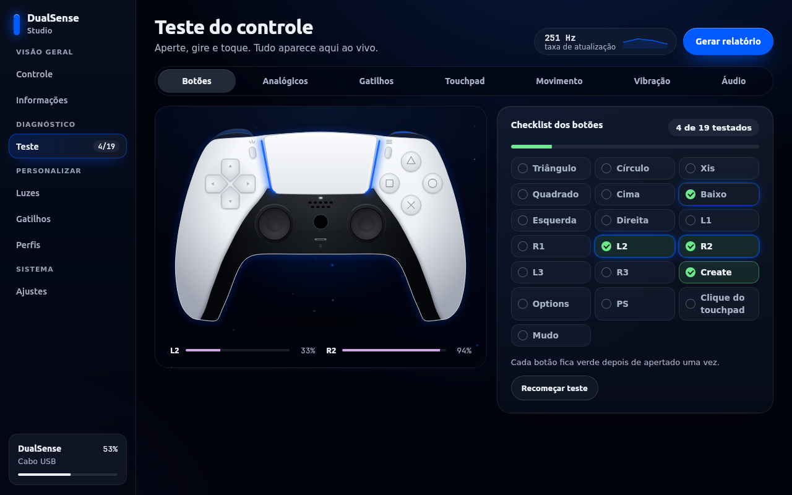
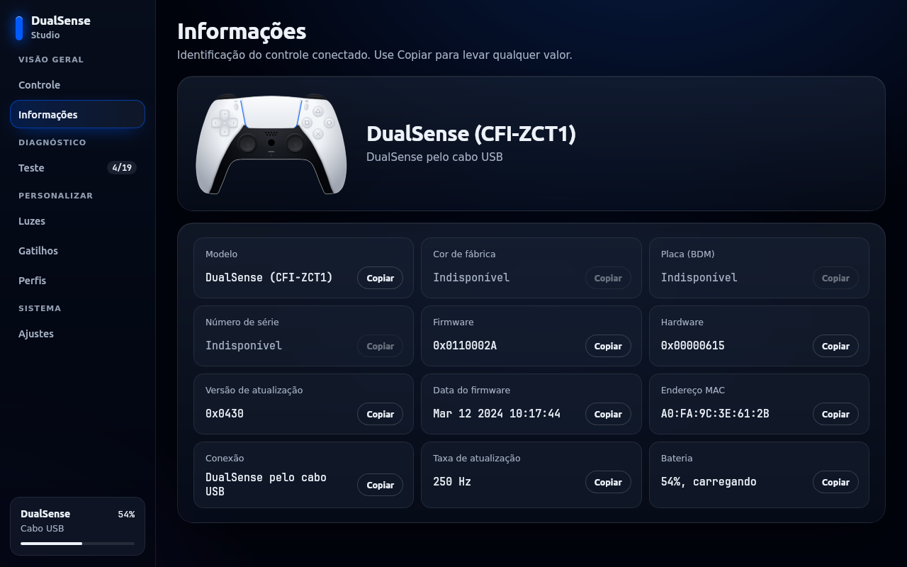

<div align="center">



# DualSense Studio

**O controle do PS5 no computador, com um visual à altura dele.**

[](https://github.com/ayramesteodosio/dualsense-studio/actions/workflows/empacotar.yml)




</div>

## O que ele faz

O controle desenhado na tela acompanha tudo ao vivo: a cor da barra de luz, os LEDs, os botões
apertados e a pressão dos gatilhos.

**🔋 Modo carregar.** No cabo USB, o controle some do sistema, até da Steam, e a barra pulsa enquanto
carrega. Dá para entrar sozinho ao ligar o cabo ou pelo atalho PS + Options.

**🌈 Luz de carga.** Cor, estilo (respirar, fixa, piscar), duração do ciclo, intensidade e o que fazer
quando encher. Muda na hora, inclusive carregando.

**💡 Luzes.** Roda de cores para a barra de luz, modo que mostra a bateria, LEDs do jogador, luz do
microfone e teste de vibração.

**🎯 Gatilhos adaptativos.** Os sete efeitos com gráfico do curso, ajuste de cada parâmetro e pressão
ao vivo.

**🩺 Teste.** Botões com checklist, analógicos (zona morta, drift, circularidade), gatilhos, touchpad,
giroscópio e acelerômetro, vibração por motor, áudio (alto-falante, fone e microfone), taxa de
atualização e relatório de diagnóstico em Markdown.

**🏷️ Informações.** Modelo, cor de fábrica, placa (BDM), número de série, firmware, hardware, MAC,
conexão e bateria.

**⚙️ E mais.** Perfis, histórico de bateria com estimativa, aviso de bateria baixa e desligamento por
inatividade no Bluetooth.

<table>
<tr>
<td></td>
<td></td>
</tr>
<tr>
<td></td>
<td></td>
</tr>
</table>

A parte que conversa com o controle vem do [Painel do DualSense](https://github.com/ayramesteodosio/dualsense-painel).
Este repo é a interface.

## Baixar

| Sistema | Como |
|---|---|
| Linux | Clone os dois repos e rode `./instalar.sh` (veja abaixo) |
| Windows | `.zip` em [Releases](https://github.com/ayramesteodosio/dualsense-studio/releases) |
| macOS (Apple Silicon e Intel) | `.zip` com o `.app` em [Releases](https://github.com/ayramesteodosio/dualsense-studio/releases) |

> [!NOTE]
> Windows e macOS foram testados com um controle simulado e com o pacote rodando no Linux, mas ainda não
> em máquinas reais. Se algo não funcionar, abra uma issue.

## Instalar no Linux

O painel precisa estar ao lado deste repo (ou no caminho da variável `DUALSENSE_PAINEL`).

```sh
git clone https://github.com/ayramesteodosio/dualsense-painel.git
git clone https://github.com/ayramesteodosio/dualsense-studio.git
cd dualsense-studio
./instalar.sh          # instala o painel também, com a regra do udev
./dualsense-studio     # ou "DualSense Studio" no menu
```

Precisa de GTK 3 e WebKitGTK 4.0 (`gir1.2-webkit2-4.0`), que já vêm no Ubuntu 22.04. Só um app
controla o controle por vez: se o painel já estiver aberto, o Studio avisa e não sobe.

## Sistemas

| | Linux | Windows | macOS |
|---|---|---|---|
| Janela | GTK e WebKit | pywebview e WebView2 | pywebview e WebKit |
| Acesso ao controle | hidraw, sysfs e usbfs | hidapi | hidapi |
| Esconder dos jogos no modo carregar | sim | com o [HidHide](https://github.com/nefarius/HidHide) | sim (abertura exclusiva) |
| Áudio do controle | PulseAudio | sounddevice | sounddevice |
| Desligar pelo Bluetooth | sim | não | não |

No Windows, sem o HidHide, o modo carregar só apaga as luzes e acompanha a bateria. Com ele, o app pede
permissão de administrador ao esconder e mostrar o controle.

Fechar a janela no Windows e no macOS encerra o app e devolve o controle ao sistema. No Linux, no modo
carregar, o app continua em segundo plano.

<details>
<summary><b>Como funciona</b></summary>

- `ui/fonte/index.html` é a fonte da interface.
- `ui/index.html` é a interface final, gerada a partir da anterior por
  `python3 ferramentas/ajustar_interface.py ui/fonte/index.html ui/index.html`. O script acrescenta
  cor, placa e série em Informações, ajusta o teste e liga a ponte com o app. Aberta direto no navegador,
  ela roda com um controle simulado (teclas `D`, `B` e `F`).
- `dualsense_studio/app.py` é a janela GTK com WebKit (Linux); `dualsense_studio/web.py` é a janela
  pywebview (Windows e macOS).
- `dualsense_studio/bridge.py` traduz as mensagens da interface para o `Session` do painel.

**Foto do controle (opcional).** Com `--foto`, o script troca o desenho por uma foto: coloque
`ui/dualsense-base.png` e a máscara da barra de luz `ui/dualsense-lightbar.png` e gere
`ui/index-foto.html`. Se os três arquivos existirem, o app usa essa versão. Use uma foto sua, não
material de divulgação da Sony. Por enquanto esses arquivos ficam fora do git.

**Mensagens.** Da interface para o app, `window.webkit.messageHandlers.ds.postMessage(...)` no Linux ou
`window.pywebview.api.send(...)` fora dele, sempre com `JSON.stringify({type, payload})`: `ready`,
`setLightbar`, `setPlayerLeds`, `setMicLed`, `setTrigger`, `testRumble`, `rumble`, `setCharging`,
`setChargeGlow`, `setAutoCharge`, `setChargeLight`, `setLightbarMode`, `setShortcut`, `setLowBattery`,
`setIdleOff`, `disconnectBluetooth`, `saveProfile`, `applyProfile`, `deleteProfile`, `audioTone`,
`micStart`, `micStop` e `saveReport`. Do app para a interface, `window.dsReceive(msg)`: `state`,
`input` (até 60 por segundo), `info`, `history`, `micLevel` e `toast`.

Para depurar a interface dentro do app: `DS_DEVTOOLS=1 ./dualsense-studio` (botão direito, Inspecionar).

</details>

<details>
<summary><b>Gerar o .exe e o .app</b></summary>

O fluxo `.github/workflows/empacotar.yml` gera os pacotes no GitHub Actions ao criar uma tag `v*` (e
publica em Releases) ou manualmente pela aba Actions. Ele baixa o `dualsense-painel` da mesma conta.

Localmente, em cada sistema:

```sh
pip install -r requirements.txt pyinstaller
DUALSENSE_PAINEL=../dualsense-painel python -m PyInstaller --noconfirm empacotar/dualsense-studio.spec
```

Os ícones saem de `dados/com.ayrames.DualSenseStudio.svg` com `python3 ferramentas/gerar_icones.py`
(precisa de cairosvg e Pillow).

</details>

## Aviso

Projeto independente, sem relação com a Sony Interactive Entertainment. DualSense, PlayStation e
DualShock são marcas da Sony Interactive Entertainment Inc. e aparecem aqui só para indicar com qual
controle o app funciona.

## Testes

```sh
PYTHONPATH=../dualsense-painel python3 -m unittest discover -s tests -t .
```
